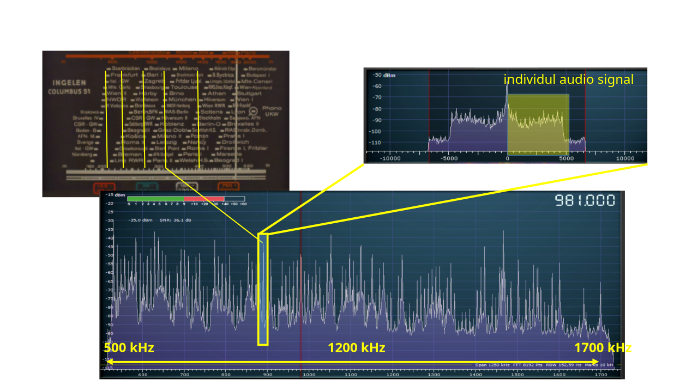
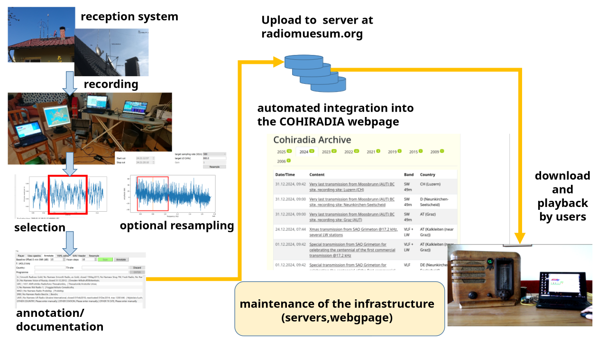
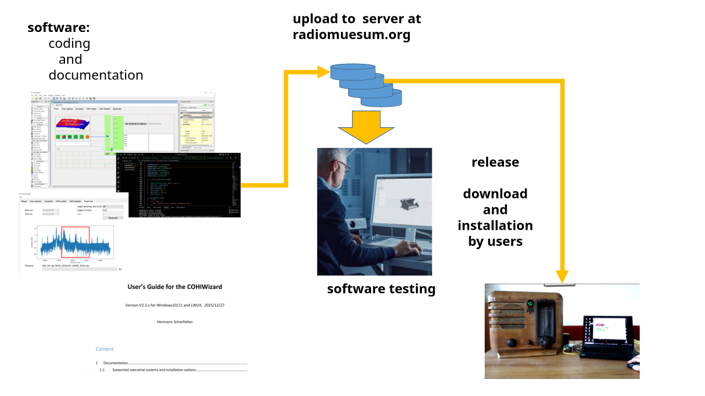
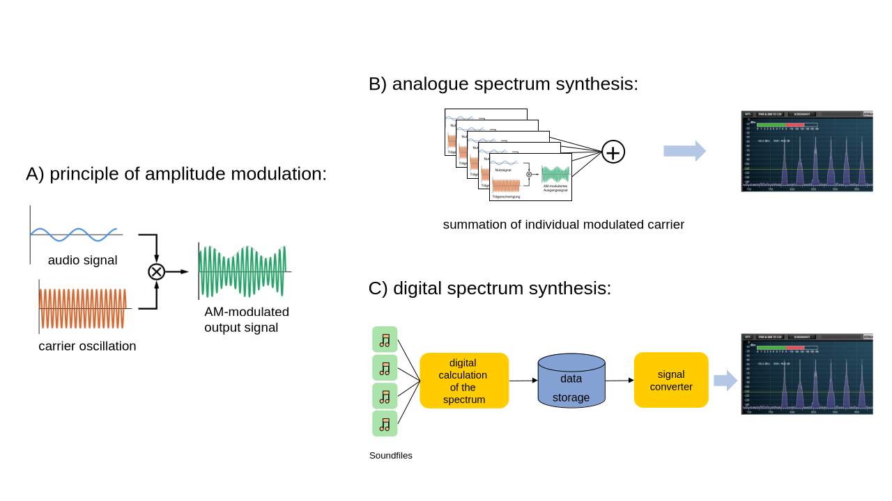

## Recording and Playback of 'Natural' Broadband Spectra

**If you prefer a video on the topic, just watch this one:**



**If you prefer text, please continue reading here:**

Basically, a variety of stations are present simultaneously in the electromagnetic spectrum. In the medium wave band, with a 9 kHz channel spacing, this can be almost 130 stations. Each station is assigned a carrier frequency. In contrast to audio signals, where only one sound source is recorded on one (mono) or two (stereo) channels, many audio signals are present simultaneously in a band, being modulated onto their respective carrier frequencies. This is schematically shown in Fig. 1: Each station that can be set on the radio dial (top left) corresponds to a peak in the entire MW spectrum, here between 500 and 1700 kHz (bottom). The broadcast receiver selects exactly the 'peak' that corresponds to the set station (top right) and demodulates the signal. Thus, only one channel is audible, although of course all are still present at the antenna input simultaneously.

*Fig. 1: Stations and their signals in the entire MW spectrum* 

If you want to offer the radio an adequate antenna signal that once existed in the past, you must have recorded the entire spectrum in its full width at that time in the past. This means a bandwidth of at least 1200 kHz instead of 2x 20 kHz for audio. Such broadband recordings can nowadays be made with special signal converters, so-called software-defined radios (SDR).

The entire recording pipeline is shown in Fig. 2: First, the AM signals are received via low-noise broadband antennas, optionally broadband preamplifiers ("systems"), digitized with SDRs, and stored on hard drives ("recording"). After that, the recordings are evaluated for quality and resampled if necessary. If they are considered suitable for the archive, the individual stations in the band are identified and annotated if possible. They are then uploaded to the COHIRADIA server. From there, any interested person can download them.

*Figure 2: Recording and processing of broadband antenna signals for the archive* 

To play back these signals, suitable software is required in addition to playback-capable signal converters that send the signals to them. Such software is continuously programmed, tested, and developed by members of the COHIRADIA team. Fig. 3 shows the software development pipeline schematically. Alternative projects have also been initiated outside of COHIRADIA by radio enthusiasts with, e.g., GNU Radio.

*Figure 3: Providing software for playback on analog radios.*

## Artificial Generation of Broadband Spectra (Synthesis in the Sense of the Jukebox)

As already described in the previous chapter, the electromagnetic signal transmitted by an AM transmitter consists of a sinusoidal carrier oscillation at the nominal transmission frequency fT and the useful signal, which is imposed on this carrier oscillation as an amplitude variation (see Fig. 4 A). If you want to artificially generate such a signal, you basically have two options:

1. Modulation of an analog signal generator with an audio signal
2. Digital synthesis on a computer from digital audio sources (e.g., wav, mp3, or similar) followed by digital-to-analog conversion (DAC).
   
If you want to generate a complete spectrum with many coexisting stations, you must combine individual signals. In case 1 (analog), you must add together several individual signals generated according to (1) with different carrier frequencies, see Fig. 4 B. In case 2 (digital), the signals of the individual transmitters are calculated from the respective audio files and then added. These sum signals are stored and provided in the same data format as directly recorded antenna signals (see Fig. 4 C). During playback, D/A conversion via the signal converter follows again.

*Figure 4: A: Principle of amplitude modulation. B: Generation of a spectrum by connecting analog modulators together. C: Generation of a spectrum by digital synthesis.* 

<!-- comment -->

## Spectra with Internet Radio Streams and Local Audio Files

The digital synthesis shown in Fig. 4 C is not limited to historical sound recordings. Both local audio files and internet radio streams can serve as audio sources for the individual carriers. In principle, there are two ways of processing:

1. **Offline synthesis (local audio files):** A complete spectrum is calculated in advance from any audio files (e.g., wav or mp3) and stored as an IQ file – just like a recorded antenna signal. Each audio file is modulated onto its own carrier at a freely selectable frequency. This option is offered by the synthesizer of the [COHIWizard](/en/docs/documentation/software/#cohiwizard). The resulting file can then be played back as often as desired with any COHIRADIA playback software.

2. **Real-time synthesis (internet radio streams and local audio files):** Here, the audio data are continuously read or received and decoded, modulated onto their respective carriers in real time, added up and passed directly to the signal converter without an intermediate file. For live content from the internet this is the only possible way, since pre-calculation is not possible. In this way, current radio programs – for example stations playing music from the heyday of the tube radio – can be heard on a historical receiver as if they were being broadcast on medium wave. This operating mode is offered by the [COHI-Player](/en/docs/documentation/software/#cohi-player) (COHI-Stream). Each carrier is fed from a stream address or an M3U playlist; such a playlist can contain local audio files as well as internet addresses. This way, your own audio content can be broadcast directly as a station without first calculating an IQ file.

Both approaches can also be combined with a static IQ recording: the COHI-Player can **mix** additional carriers modulated by internet radio streams or local audio files (via M3U playlists) **into** a running recording – be it a natural spectrum recorded from the antenna or an offline-synthesized one (operating mode COHI-Player+Stream). This results, for example, in a historical medium wave band in which current programs or your own audio content can additionally be heard on some free frequencies.

A few technical constraints must be observed:

* **Choice of frequencies:** The additional carriers should be placed on frequencies that are free in the recording and sufficiently spaced from each other (typically a 9 kHz channel raster in the medium wave band) so that the sidebands do not overlap. It is also important to place the added carriers exactly on the 9 kHz raster of the frequency plan underlying the IQ recording. If an added carrier lies outside this raster, beating with the carrier on the neighbouring raster frequency produces audible **whistling interference**. The pitch of the whistle typically corresponds to the difference between the frequency of the added carrier and the neighbouring raster frequency in the IQ spectrum – a carrier at 1000 kHz next to a station on the raster frequency 999 kHz, for example, produces a 1 kHz whistle.
* **Audio bandwidth:** The audio bandwidth of each carrier is limited (e.g., to 4.5 kHz), which corresponds to the bandwidth of AM transmitters of the time and avoids interference with adjacent channels.
* **Computing power:** Since modulation takes place in real time, the number of simultaneous carriers is limited by the computing power – to a few dozen on the Raspberry Pi 4, correspondingly more on the Raspberry Pi 5. With the fl2k dongle, which, unlike the STEMLAB, has no signal processing of its own (FPGA), the limits are tighter (see [Platforms and performance](/en/docs/documentation/software/#cohi-player)).
* **Network:** Uninterrupted playback of internet radio streams requires a stable internet connection, preferably via LAN cable.
